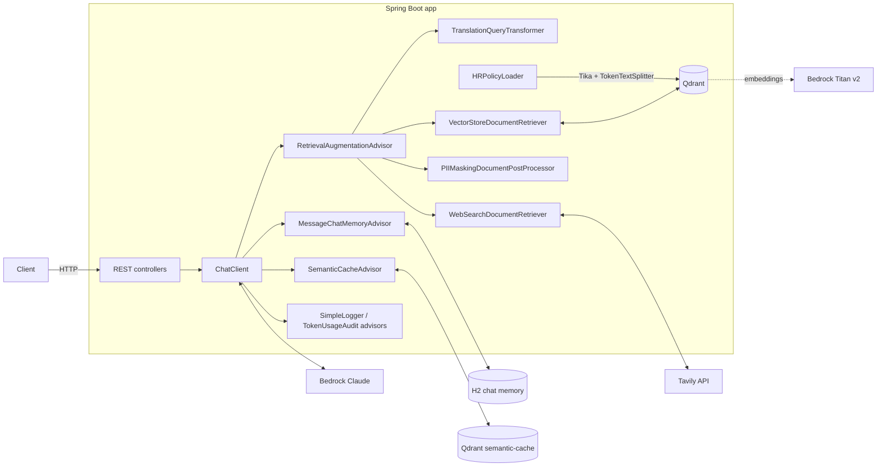

# spring-ia

A hands-on playground for building AI-powered Java applications with **Spring Boot 4** and **Spring AI 2**,
backed by **Anthropic Claude on AWS Bedrock**.

The project grows step by step from a simple "hello world" chat endpoint to a full
**Retrieval-Augmented Generation (RAG)** pipeline with persistent chat memory, a vector database,
web search, PII masking and semantic caching.

---

## Table of contents

- [Features](#features)
- [Tech stack](#tech-stack)
- [Architecture](#architecture)
- [Getting started](#getting-started)
- [Configuration](#configuration)
- [API reference](#api-reference)
- [Concepts covered](#concepts-covered)
- [Project structure](#project-structure)
- [Troubleshooting](#troubleshooting)
- [Roadmap](#roadmap)

---

## Features

| Area | What it shows |
|---|---|
| **Chat basics** | `ChatClient` with default system/user messages, message roles, `ChatOptions` (model, max tokens) |
| **Prompt engineering** | Prompt templates (`.st` files with parameters) and prompt stuffing |
| **Advisors** | Built-in `SimpleLoggerAdvisor` and a custom `TokenUsageAuditAdvisor` |
| **Streaming** | Real-time token streaming with `stream()` and `Flux<String>` |
| **Structured output** | Mapping LLM answers to a Java record, `List`, `Map` and `List<POJO>` |
| **Chat memory** | Per-user conversations (`CONVERSATION_ID`), persisted in H2 via JDBC, bounded with `maxMessages` |
| **RAG** | Qdrant vector store, Titan embeddings, PDF ingestion with Apache Tika, token-based chunking |
| **Advanced RAG** | `RetrievalAugmentationAdvisor`, query translation (pre-retrieval), PII masking (post-retrieval) |
| **Web search RAG** | Custom `DocumentRetriever` backed by the Tavily search API |
| **Semantic caching** | `SemanticCacheAdvisor` answers similar questions from a cache instead of calling the LLM (Qdrant, Redis variant included) |

---

## Tech stack

| Component | Version / choice |
|---|---|
| Java | 21 |
| Spring Boot | 4.1.x |
| Spring AI | 2.0.x |
| Chat model | Anthropic Claude Sonnet via **AWS Bedrock Converse** |
| Embedding model | **Amazon Titan Text Embeddings v2** (`amazon.titan-embed-text-v2:0`, 1024 dimensions) |
| Vector store | **Qdrant** (started automatically with Docker Compose) |
| Chat memory store | **H2** file database (`~/chatmemory`) via `JdbcChatMemoryRepository` |
| Document reader | Apache **Tika** (`spring-ai-tika-document-reader`) |
| Web search | **Tavily** Search API |
| Semantic cache | `spring-ai-redis-semantic-cache` `DefaultSemanticCache`, stored in a dedicated Qdrant collection |
| Build | Maven (wrapper included) |

---

## Architecture



**RAG flow for `/api/rag/document/chat`:**

1. **Semantic cache check:** if a question at least 80% similar was already answered, the cached
   answer is returned right away, with no retrieval and no LLM call.
2. The user question is translated to English (`TranslationQueryTransformer`).
3. The question is embedded with Titan v2 and the top 3 most similar chunks are fetched from Qdrant
   (`similarityThreshold = 0.2`).
4. Emails and phone numbers are masked in the retrieved chunks (`PIIMaskingDocumentPostProcessor`).
5. The chunks are added to the prompt, together with the user's last 10 messages from chat memory.
6. Claude answers using only that context. If nothing relevant is found, it says the question
   is outside its knowledge base. The answer is stored in the semantic cache.

---

## Getting started

### Prerequisites

- **JDK 21**
- **Docker** (Docker Desktop on Windows/macOS). Qdrant is started automatically from `compose.yml`.
- An **AWS account** with Bedrock access in `eu-west-2` to:
  - an Anthropic Claude inference profile
  - `amazon.titan-embed-text-v2:0`
- A **Tavily API key** (free tier available at <https://tavily.com>). It's required at startup
  because the web-search ChatClient is created eagerly.

### 1. Provide your credentials

**Option A: environment variables**

```bash
export AWS_ACCESS_KEY_ID=<your-access-key>
export AWS_SECRET_ACCESS_KEY=<your-secret-key>
export TAVILY_SEARCH_API_KEY=<your-tavily-key>
```

On Windows PowerShell:

```powershell
$env:AWS_ACCESS_KEY_ID="<your-access-key>"
$env:AWS_SECRET_ACCESS_KEY="<your-secret-key>"
$env:TAVILY_SEARCH_API_KEY="<your-tavily-key>"
```

**Option B: local file (AWS keys only).** Create `src/main/resources/secrets.properties`:

```properties
spring.ai.bedrock.aws.access-key=<your-access-key>
spring.ai.bedrock.aws.secret-key=<your-secret-key>
```

It's loaded automatically through `spring.config.import`, overrides the environment-variable
placeholders, and is **git-ignored**.

> Never commit credentials. `application.properties` only references environment variables.

### 2. Run the application

```bash
./mvnw spring-boot:run
```

On startup the application:

1. starts the Qdrant container (`spring-boot-docker-compose`),
2. creates the `chat_memory` and `semantic-cache` collections and the H2 chat-memory schema,
3. reads `HR_Policies.pdf`, splits it into ~200-token chunks, embeds them and stores them in Qdrant.

The API is available at `http://localhost:8080`.

### 3. Try it

```bash
curl -H "username: alice" "http://localhost:8080/api/rag/document/chat?message=What%20is%20the%20notice%20period%3F"
```

### Useful UIs

| Tool | URL |
|---|---|
| Qdrant dashboard | <http://localhost:6333/dashboard> |
| H2 console (chat memory) | <http://localhost:8080/h2-console> (JDBC URL `jdbc:h2:file:~/chatmemory`) |

---

## Configuration

Main settings in [`application.properties`](src/main/resources/application.properties):

| Property | Purpose |
|---|---|
| `spring.ai.model.chat=bedrock-converse` | Use the Bedrock Converse API for chat |
| `spring.ai.bedrock.aws.region` | AWS region (`eu-west-2`) |
| `spring.ai.bedrock.converse.chat.model` | Claude inference profile ARN. Replace it with your own |
| `spring.ai.model.embedding=bedrock-titan` | Use Titan for embeddings |
| `spring.ai.bedrock.titan.embedding.model` | `amazon.titan-embed-text-v2:0` |
| `spring.ai.vectorstore.qdrant.*` | Qdrant host/port (gRPC `6334`), collection name, schema init |
| `spring.config.import=optional:classpath:secrets.properties` | Load local credentials from the git-ignored file |
| `spring.datasource.*` | H2 file database for chat memory |
| `spring.ai.chat.memory.repository.jdbc.initialize-schema=always` | Create the chat memory table on startup |
| `logging.level.org.springframework.ai.chat.client.advisor=DEBUG` | Show full prompts/responses from `SimpleLoggerAdvisor` |

RAG tuning lives in [`ChatMemoryChatClientConfig`](src/main/java/com/spring/ia/config/ChatMemoryChatClientConfig.java)
(`topK`, `similarityThreshold`, query transformers, post-processors) and chunking in
[`HRPolicyLoader`](src/main/java/com/spring/ia/rag/HRPolicyLoader.java). Semantic cache settings
(storage, `similarityThreshold = 0.8`) live in
[`SemanticCacheConfig`](src/main/java/com/spring/ia/config/SemanticCacheConfig.java).

---

## API reference

All endpoints are `GET`. Endpoints that use chat memory need a **`username` header**, which is used
as the conversation id.

### Chat basics

| Endpoint | Params | Description |
|---|---|---|
| `/api/chat` | `message` | IT-helpdesk assistant (system message), logs token usage |
| `/api/stream` | `message` | Streams the answer token by token (`Flux<String>`) |

```bash
curl "http://localhost:8080/api/chat?message=How%20do%20I%20reset%20my%20password%3F"
curl -N "http://localhost:8080/api/stream?message=Tell%20me%20a%20short%20story"
```

### Prompt engineering

| Endpoint | Params | Description |
|---|---|---|
| `/api/email` | `customerName`, `customerMessage` | Drafts a customer-service email from [`userPromptTemplate.st`](src/main/resources/promptTemplates/userPromptTemplate.st) |
| `/api/prompt-stuffing` | `message` | HR assistant answering from a policy summary stuffed into [`systemPromptTemplate.st`](src/main/resources/promptTemplates/systemPromptTemplate.st) |

```bash
curl "http://localhost:8080/api/email?customerName=John&customerMessage=My%20order%20arrived%20damaged"
curl "http://localhost:8080/api/prompt-stuffing?message=How%20many%20paid%20leaves%20do%20I%20get%3F"
```

### Structured output

| Endpoint | Returns | Converter |
|---|---|---|
| `/api/chat-bean` | `CountryCities` | `entity(CountryCities.class)` |
| `/api/chat-list` | `List<String>` | `ListOutputConverter` |
| `/api/chat-map` | `Map<String, Object>` | `MapOutputConverter` |
| `/api/chat-bean-list` | `List<CountryCities>` | `ParameterizedTypeReference` |

```bash
curl "http://localhost:8080/api/chat-bean?message=Give%20me%205%20cities%20in%20Italy"
curl "http://localhost:8080/api/chat-bean-list?message=Give%20me%203%20cities%20for%20France%20and%20Spain"
```

### Chat memory

| Endpoint | Header | Params | Description |
|---|---|---|---|
| `/api/chat-memory` | `username` | `message` | Stateful conversation, last 10 messages kept per user in H2 |

```bash
curl -H "username: alice" "http://localhost:8080/api/chat-memory?message=My%20name%20is%20Alice"
curl -H "username: alice" "http://localhost:8080/api/chat-memory?message=What%20is%20my%20name%3F"
```

### RAG

| Endpoint | Header | Params | Description |
|---|---|---|---|
| `/api/rag/document/chat` | `username` | `message` | Answers HR questions from `HR_Policies.pdf` stored in Qdrant |
| `/api/rag/random/chat` | `username` | `message` | Same pipeline over sample sentences (enable `@Component` on `RandomDataLoader` first) |
| `/api/rag/web-search/chat` | `username` | `message` | Answers from live Tavily web search results |

```bash
curl -H "username: alice" "http://localhost:8080/api/rag/document/chat?message=How%20many%20weeks%20of%20maternity%20leave%3F"
curl -H "username: alice" "http://localhost:8080/api/rag/web-search/chat?message=Latest%20Spring%20AI%20release"
```

### Semantic cache

| Endpoint | Params | Description |
|---|---|---|
| `/api/semantic-chat` | `message` | General chat with a semantic cache. Rephrased questions reuse the cached answer |

```bash
curl "http://localhost:8080/api/semantic-chat?message=What%20is%20the%20capital%20of%20France%3F"
# Similar meaning, different words: answered from the cache (check the logs, no token usage)
curl "http://localhost:8080/api/semantic-chat?message=Tell%20me%20France's%20capital%20city"
```

---

## Concepts covered

### Prompts and messages
- **Message roles**: `system` scopes the assistant and `user` carries the question.
- **Defaults**: `defaultSystem`, `defaultUser`, `defaultOptions` and `defaultAdvisors` on `ChatClient.Builder`.
- **Prompt templates**: StringTemplate `.st` files with `{placeholders}` filled at runtime.
- **Prompt stuffing**: putting reference data directly into the prompt. It's simple, but it doesn't
  scale to large documents, which is why RAG exists.

### Advisors
Advisors intercept every call made through a `ChatClient` (similar to servlet filters):
- `SimpleLoggerAdvisor`: logs the full request and response.
- `TokenUsageAuditAdvisor` (custom `CallAdvisor`): logs prompt/completion token usage.
- `MessageChatMemoryAdvisor`: injects conversation history.
- `RetrievalAugmentationAdvisor`: injects retrieved documents.
- `SemanticCacheAdvisor`: short-circuits the call when a similar question is already cached.

### Structured output
`call().entity(...)` adds format instructions to the prompt and converts the answer into Java types:
records, lists, maps or generic collections via `ParameterizedTypeReference`.

### Chat memory
LLMs are stateless. `MessageWindowChatMemory` stores past messages per `CONVERSATION_ID` and
replays the last *N* (`maxMessages = 10`) on every call. Keeping that window small keeps costs and
the context window under control. History is persisted in H2, so it survives restarts.

### Retrieval-Augmented Generation
1. **Ingest**: read documents (Tika), split them into chunks (`TokenTextSplitter`), embed them (Titan v2)
   and store them in Qdrant.
2. **Retrieve**: embed the question and fetch the nearest chunks (cosine similarity, `topK`, threshold).
3. **Augment**: add the chunks to the prompt.
4. **Generate**: the LLM answers grounded in that context.

Advanced modules used here:
- **Pre-retrieval**: `TranslationQueryTransformer` translates the query to English so it matches the
  document language.
- **Post-retrieval**: `PIIMaskingDocumentPostProcessor` redacts emails and phone numbers before they
  reach the LLM.
- **Custom retriever**: `WebSearchDocumentRetriever` turns Tavily search hits into `Document`s.

### Semantic caching
A classic cache only hits on the exact same key. A **semantic cache** embeds each question and looks
for a previously answered question with a similar *meaning* (`similarityThreshold = 0.8`):

- **Hit**: the stored answer is returned, with no LLM call, no tokens paid and an instant response.
- **Miss**: the LLM answers and the question/answer pair is stored for next time.

The cache started on **Redis** (`DefaultSemanticCache` with a Jedis client, still in the code as
comments, with Redis in `compose.yml`). It now reuses the existing **Qdrant** instance with a
dedicated `semantic-cache` collection, so no extra infrastructure is needed. It's applied both to
`/api/semantic-chat` and to the RAG chat client.

---

## Project structure

```
src/main/java/com/spring/ia
├── advisors/
│   └── TokenUsageAuditAdvisor.java          # custom advisor logging token usage
├── config/
│   ├── ChatClientConfig.java                # default ChatClient (system prompt, options)
│   ├── ChatMemoryChatClientConfig.java      # chat memory + RAG + semantic cache advisors
│   ├── SemanticCacheConfig.java             # semantic cache (Qdrant store, Redis variant)
│   ├── SemanticChatClientConfig.java        # ChatClient with the semantic cache
│   └── WebSearchRAGChatClientConfig.java    # web-search RAG ChatClient
├── controller/
│   ├── ChatController.java                  # /api/chat
│   ├── StreamController.java                # /api/stream
│   ├── PromptTemplateController.java        # /api/email
│   ├── PromptStaffingController.java        # /api/prompt-stuffing
│   ├── StructuredOutPutController.java      # /api/chat-bean, -list, -map, -bean-list
│   ├── ChatMemoryController.java            # /api/chat-memory
│   ├── RAGController.java                   # /api/rag/**
│   └── SemanticChatController.java          # /api/semantic-chat
├── model/
│   └── CountryCities.java
└── rag/
    ├── HRPolicyLoader.java                  # PDF → chunks → Qdrant
    ├── RandomDataLoader.java                # sample sentences → Qdrant (disabled)
    ├── PIIMaskingDocumentPostProcessor.java # post-retrieval PII redaction
    └── WebSearchDocumentRetriever.java      # Tavily-backed DocumentRetriever

src/main/resources
├── application.properties
├── secrets.properties                       # local credentials (git-ignored, you create it)
├── HR_Policies.pdf
└── promptTemplates/*.st
compose.yml                                  # Qdrant (Redis commented out)
```

---

## Troubleshooting

| Symptom | Cause / fix |
|---|---|
| RAG answers *"that falls outside my knowledge base"* | No chunk passed the `similarityThreshold`. Titan v2 scores short questions against long chunks low (~0.25), so keep the threshold around `0.2` or use smaller chunks. Check the stored points in the Qdrant dashboard. |
| `Environment variable TAVILY_SEARCH_API_KEY must be set` on startup | Set `TAVILY_SEARCH_API_KEY`. The web-search ChatClient is created at startup. |
| `400 Missing request header 'username'` | Memory and RAG endpoints need the `username` header, so use `curl -H` or Postman instead of a browser. |
| Duplicate chunks in Qdrant | `HRPolicyLoader` re-ingests the PDF on every start. Delete the collection or add an "already loaded" check. |
| Semantic cache returns an answer to a *different* question | The 0.8 threshold is too loose for your questions. Raise it in `SemanticCacheConfig`, or delete the `semantic-cache` collection in the Qdrant dashboard to clear the cache. |
| Bedrock `AccessDeniedException` | Enable model access for Claude and Titan in the Bedrock console for your region. |

---

## Roadmap

- [x] Chat basics, prompts, advisors, streaming and structured output
- [x] Chat memory with JDBC persistence
- [x] RAG with Qdrant, plus advanced RAG (pre/post-retrieval, web search)
- [x] **Semantic caching**: reuse answers to semantically similar questions (Redis, then Qdrant)

- [ ] **Tool calling**: let the LLM call Java methods (current time, database queries) and customize tool errors
- [ ] **Model Context Protocol (MCP)**: MCP client and server (STDIO and remote), tool filtering, sampling, elicitation
- [ ] **Evaluation**: `RelevancyEvaluator` and `FactCheckingEvaluator` in tests, plus runtime checks with Spring Retry
- [ ] **Observability**: Actuator metrics, Prometheus and Grafana dashboards, OpenTelemetry tracing with Jaeger
- [ ] **Audio and images**: transcription, text-to-speech and image generation
- [ ] **AI agent**: an end-to-end agent combining RAG, tools and MCP
